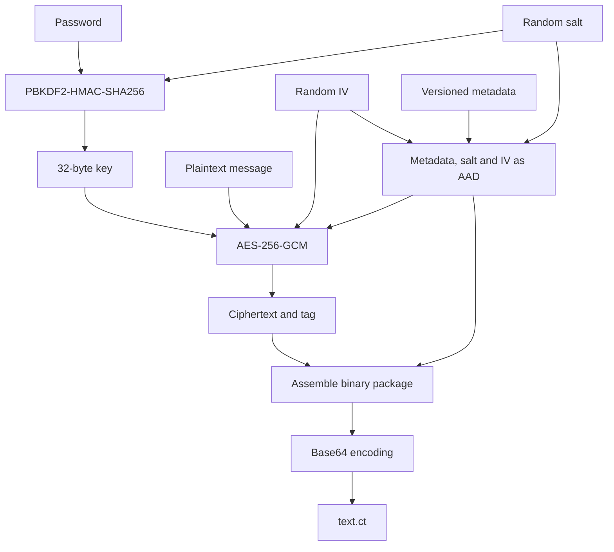
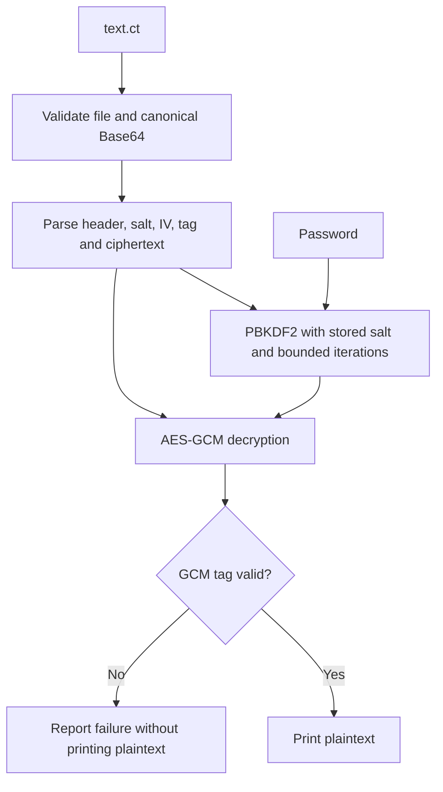

# Beginner's Guide to the Encryption Example

**AES-256-GCM SOS Assignment Task 4 -Encryption Decryption | Format Version 1 | Beginner Walkthrough**

This guide follows one message from keyboard input to an encrypted file and back again. No cryptography background is assumed. The companion [security report](SECURITY.md) records the historical weaknesses, CWE mappings, implemented controls and testing limits.

> This is a coursework example, not a production security product. No independent audit has been performed.

## The Basic Idea

Encryption turns readable information, called **plaintext**, into unreadable-looking information, called **ciphertext**. A **password** is used to make a cryptographic key. The key encrypts and later decrypts the message.

This program uses AES-256-GCM. AES is the encryption algorithm; `256` means its key is 256 bits (32 bytes); GCM is a mode that also checks that the ciphertext was not changed. The check value is called an **authentication tag**. If the tag does not verify, the program must not show the decrypted text.

The password is not used directly as the AES key. PBKDF2, a password-based key derivation function, repeatedly processes the password with a random **salt** to make the key. The salt is stored with the encrypted message; it is not a secret. The repeated work makes guessing passwords from a stolen ciphertext slower.

AES-GCM also needs a unique **IV** (initialization vector, also called a nonce) for each encryption with a given key. The IV is stored with the ciphertext and does not need to be secret. Reusing an IV with the same key can seriously weaken GCM, so this program generates a new random IV for each encryption.

**Base64 is not encryption.** It converts binary bytes into printable characters so the encrypted data can be written as text in `text.ct`.

## Encryption Flow



## Decryption Flow



The same password and stored salt recreate the key. Decryption initially produces tentative plaintext bytes in memory; those bytes are not trusted or displayed until the tag verifies.

## File Format

The binary data stored before Base64 encoding has this layout:

| Part | Size | Purpose |
| --- | ---: | --- |
| Magic | 4 bytes | `T41E`, identifying the format |
| Version | 1 byte | `1`, identifying the supported layout |
| KDF ID | 1 byte | `1`, meaning PBKDF2-HMAC-SHA256 |
| Iteration count | 4 bytes | PBKDF2 work factor, stored big-endian |
| Ciphertext length | 4 bytes | Exact message/ciphertext byte count, stored big-endian |
| Salt | 16 bytes | Recreates the same derived key during decryption |
| IV | 12 bytes | Recreates the GCM operation; generated randomly for each encryption |
| GCM tag | 16 bytes | Lets the decryptor detect the wrong password or changed data |
| Ciphertext | Same size as the message | The encrypted message bytes |

The salt, IV, tag, and ciphertext are all stored together. None of these fields is a substitute for the password: keep the password private and choose a strong one.

The first 42 bytes (metadata, salt, and IV) are supplied to GCM as **additional authenticated data (AAD)**. This data is readable, but changing it makes authentication fail. The tag starts at byte offset 42 and ciphertext starts at offset 58. The decoder bounds the iteration count to 600,000 through 2,000,000 before doing that much work; the header is only trusted after GCM verifies it.

**PBKDF2-HMAC-SHA256** expands to a password-based key derivation function using HMAC with SHA-256. Here it performs 600,000 iterations to make each password guess cost more work. It does not prevent offline guesses or rescue an easily guessed password.

**OpenSSL EVP** is the library's high-level cryptographic interface. This project calls OpenSSL rather than implementing AES or GCM itself.

## C Concepts Used

| Code element | Meaning in this project |
| --- | --- |
| `.h` header / `.c` source | Shared declarations / executable function definitions |
| Byte and bit | A byte contains 8 bits; 32 key bytes equal 256 bits |
| Buffer and pointer | Storage for bytes and a reference to that storage |
| `unsigned char` | A byte value suitable for arbitrary binary data |
| `\0` / NUL | The C-string terminator; not the printable digit `0` |
| `malloc` / `free` | Allocate and release memory; releasing alone does not erase it |
| `NULL` / `-1` | Common failure indicators for pointers / file descriptors |
| `goto cleanup` | Send ordinary success/error paths to a single resource-release section |
| `OPENSSL_cleanse` | Overwrite selected secret buffers in a way the compiler should not remove |
| `EXIT_SUCCESS` / `EXIT_FAILURE` | Tell the calling shell whether the operation succeeded |

Limits in this project count bytes, not necessarily visible characters. A Unicode character may occupy several bytes.

## Files at a Glance

| File | Responsibility |
| --- | --- |
| [crypto_common.h](vuln_lab/crypto_common.h) | Shared settings, header layout and function declarations |
| [crypto_common.c](vuln_lab/crypto_common.c) | Header parsing, key derivation, Base64 and password input |
| [task41enc.c](vuln_lab/task41enc.c) | Encrypt a message and safely publish the output file |
| [task41dec.c](vuln_lab/task41dec.c) | Validate, decrypt and verify before displaying plaintext |
| [Makefile](vuln_lab/Makefile) | Compile and link the programs with hardening flags |
| [build.sh](vuln_lab/build.sh) | Invoke the Makefile without cleaning ciphertext first |

### Shared Header

This header is shared by both programs. It includes OpenSSL and standard C declarations, sets the parameters and size limits, defines the function-pointer type for key derivation, and declares shared helper functions.

Key settings include:

- `SALT_LEN`, `IV_LEN`, `KEY_LEN`, and `TAG_LEN`: the sizes of the cryptographic fields.
- `PBKDF2_ITER`: 600,000 PBKDF2 iterations.
- `MIN_PASS_LEN`: new encryption passwords must be at least 12 bytes. This does not guarantee they are hard to guess.
- `MAX_MSG_LEN`: storage allocated for a message including its terminating NUL byte. Because one byte is reserved for that terminator, the current input loop accepts at most 4,095 message bytes.
- `MAX_PASS_LEN`: password buffer size including its terminating NUL byte. The largest accepted password is 255 bytes.
- `MAX_PASSWORD_ATTEMPTS`: three attempts per program run, including invalid input or confirmation mismatches.
- `OUTPUT_FILE`: the ciphertext filename, `text.ct`.
- `HEADER_LEN` and `MAX_B64_LEN`: derived sizes used by the decoder to validate file contents before using them.

The header also defines `kdf_fn_t`, a C function-pointer type describing the arguments and result expected from a key-derivation function. The programs assign `derive_key` to this type before calling it; this leaves room to swap the KDF implementation without changing the call pattern.

### Shared Helpers

This file implements helpers used by the encoder and decoder:

- `derive_key()` calls OpenSSL's `PKCS5_PBKDF2_HMAC()` with SHA-256, a validated iteration count, the salt, and a 32-byte output key. `make_header()` and `parse_header()` serialize and validate metadata without depending on C structure padding or machine byte order.
- `base64_encode()` writes binary input through an OpenSSL Base64 BIO and returns a heap-allocated printable string. It checks BIO operations and the memory-buffer result. On failure it frees the BIO chain and returns `NULL` so the caller can clean up.
- `base64_decode()` checks the Base64 length, alphabet, and padding, decodes with `EVP_DecodeBlock()`, then re-encodes and compares the entire string. This rejects noncanonical encodings, including altered unused padding bits. Invalid data or allocation failure returns `NULL`.
- `read_password()` disables terminal echo for interactive input, reads the entire line, rejects overlong or NUL-containing input, and clears a rejected buffer. Temporary handlers restore terminal settings and exit on SIGINT, SIGTERM, SIGHUP, SIGQUIT and SIGTSTP while the password is being read. SIGTSTP exits rather than suspending. SIGKILL/SIGSTOP cannot be caught. Both programs disable stdin buffering before any input so stdio does not retain a separate secret-input buffer.
- The password reader returns the byte count on success, `PASSWORD_INVALID` for an invalid line, and `-1` for an I/O failure or empty EOF. This lets callers retry input mistakes without looping indefinitely on a closed input stream.
- `crypto_error()` is a simple print-and-exit helper retained in the shared module. The encoder and decoder use their own cleanup paths instead, so errors after sensitive data is read do not bypass cleanup.

### Encryptor Walkthrough

The encoder performs these steps:

1. **Prepare input and output policy.** Disable stdin buffering. If output already exists, request confirmation on `/dev/tty`; refuse symlinks, non-regular paths or unconfirmed replacement.
2. **Read the message.** Read through the newline and reject empty, ASCII-whitespace-only, overlong or NUL-containing input. At least one non-whitespace byte is required; valid messages are not trimmed. A C string ends at NUL, so accepting one could make string operations handle only part of the input.
3. **Read and confirm the password.** `read_password()` hides terminal input. Encryption requires 12 through 255 password bytes and asks for the password twice. Invalid input or mismatched confirmation prompts again without asking for the message again, up to three attempts. Encryption is choosing a new password, so a valid-length typo can only be caught by confirmation, not by comparing with an existing secret. EOF or an input error stops the operation.
4. **Create salt, IV and header.** `RAND_bytes()` generates the random fields. `make_header()` records version, KDF ID, iterations and exact message length. Random-generation failure stops encryption.
5. **Derive the key.** `derive_key()` uses password, salt and 600,000 iterations to produce the AES key. Only the salt and settings, not the password or key, go into the file.
6. **Encrypt and authenticate.** `EVP_EncryptInit_ex()` selects AES-256-GCM and supplies key/IV. `EVP_EncryptUpdate()` first authenticates the 42-byte AAD header with no output buffer, then encrypts the message. `EVP_EncryptFinal_ex()` completes the operation; `EVP_CTRL_GCM_GET_TAG` retrieves the tag.
7. **Package and encode.** Combine metadata, salt, IV, tag and ciphertext, then Base64-encode the package.
8. **Publish output.** Write and flush a mode-`0600` temporary file. A hard link publishes new output only if the destination does not exist. Confirmed replacements recheck the original file's identity before renaming.
9. **Clean up.** Ordinary paths release allocated resources, remove unfinished temporary output, and cleanse password, key, message and selected working buffers. Signal exits are a separate case, explained below.

The `EVP_CIPHER_CTX` is an OpenSSL object that holds the state of an encryption operation. The `EVP_*` functions are OpenSSL's calls for setting up, running, and finishing that operation. Most return a success value; the code checks those values and takes the cleanup path on failure.

### Decryptor Walkthrough

The decoder reverses the process, with an important verification step:

1. **Read and bound the file.** It opens input with `O_NOFOLLOW` to reject a final-component symlink, requires a regular file, and checks its size with `fstat` before allocating. It checks for bytes beyond that measured content.
2. **Validate and decode Base64.** It rejects embedded NUL bytes, accepts at most one optional LF or CRLF ending, and calls the canonical `base64_decode()` helper. Additional trailing whitespace or data is rejected.
3. **Check the header and package size.** It requires recognized magic, version and KDF ID, a bounded iteration count, and an exact nonempty ciphertext length. Older headerless files are rejected.
4. **Recover fields.** Pointers identify the salt, IV, tag, and ciphertext inside the decoded package. These pointers refer to existing memory; the program does not allocate separate copies for each field.
5. **Derive the key.** The password and stored salt are passed through PBKDF2 using the bounded iteration count from the header.
6. **Decrypt and verify.** The decoder supplies the exact header bytes as AAD, then `EVP_DecryptUpdate()` produces plaintext in memory. These bytes are not printed yet. `EVP_DecryptFinal_ex()` checks the tag. Failure reports "wrong password or modified ciphertext" and prompts again, up to three attempts; GCM cannot distinguish those two causes. The rejected key/password/plaintext are cleansed and the GCM context is reset for the next attempt. Invalid password lines also count as attempts; EOF or an input error exits immediately.
7. **Print only verified plaintext.** The program adds a NUL terminator and prints the message only after tag verification succeeds.
8. **Clean up ordinary returns.** Both normal success and handled error paths close files, free the OpenSSL context and buffers, and cleanse the password, key and plaintext. A signal-triggered `_exit` bypasses this memory cleanup after attempting terminal restoration.

The authentication tag is essential: decryption can produce bytes even when the password is wrong or the ciphertext was changed. The result must be treated as untrusted until GCM verification succeeds.

### Build Process

The Makefile compiles `crypto_common.c` once into `crypto_common.o`, then links it into `task41enc` and `task41dec`. It discovers OpenSSL through `pkg-config`, falls back to Homebrew on macOS, or uses system paths. It links only `libcrypto`. Default flags enable stack protection, fortification and position-independent executables; Linux also gets RELRO, immediate binding and a non-executable stack. Compiler and hardening variables can be overridden. Linux is a portability target; this update was executed on macOS only.

From the workspace root, enter the source directory and run the build helper:

```sh
cd vuln_lab
./build.sh
```

The script calls `make all`; it does not clean first. `make clean` removes the object file, both programs, and `text.ct`, so do not use that target if you need to keep the generated ciphertext. PIE randomization support and stack protection are additional defenses, not substitutes for correct bounds checks and authentication.

## Safe Demonstration

Run the following from the workspace root to build the tools and create an isolated demonstration directory. Existing repository ciphertext is not used or overwritten.

```sh
make -C vuln_lab all
lab_dir="$PWD/vuln_lab"
demo_dir=$(mktemp -d)
cd "$demo_dir"
"$lab_dir/task41enc"
"$lab_dir/task41dec"
```

Use a nonempty demonstration message and a disposable passphrase of at least 12 bytes. The password is not displayed while typing. The encoder creates `text.ct` in this temporary directory; the decoder prompts for the same password.

| Demonstration | Expected result |
| --- | --- |
| Enter only spaces or tabs as the message | Input rejected before the password prompt; no output file created |
| Decrypt with the correct password | Original message displayed |
| Decrypt with the wrong password | Authentication failure, then another password prompt; no unverified message displayed |
| Run encryption again with existing output | Replacement confirmation before message input |
| Enter a password shorter than 12 bytes | Another password prompt, without re-entering the message |
| Enter different passwords at confirmation | Another password/confirmation attempt |
| Fail three password attempts | Program exits with failure |
| Change the tag or ciphertext bytes | Authentication failure, or parsing failure if the format was damaged |

Repeated encryption with the same message/password produces different files because salt and IV change. The recorded test suite also exercised malformed files, canonical padding, size limits, file races, terminal signals, and selected ASan/UBSan paths. Linux received a build-recipe dry run only; testing limits are listed in the [verification section](SECURITY.md#verification).

## Closing Summary

**The central lesson is implementation discipline:** AES-GCM provides encryption and authentication, but the application must use fresh randomness, derive keys carefully, validate every file, check authentication before output, and handle local resources safely. CWE mappings explain the mistakes; testing supplies evidence about exercised paths, not a guarantee of complete security.