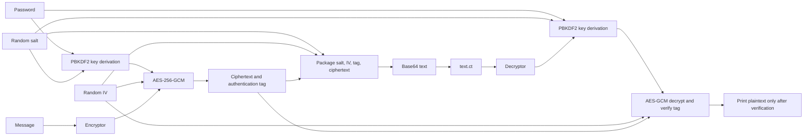

# AES-256-GCM Teaching Utility

This directory contains a small password-based encryption/decryption example. It is intended for coursework, not production use; it has not undergone a security audit. Build with:

For a beginner-friendly explanation of the cryptography and each source file, see [GUIDE.md](GUIDE.md).

```sh
make all
```

`make clean` removes the generated ciphertext file `text.ct` in addition to build outputs.

## Checks
1. Run an encrypt/decrypt round trip.
2. Modify `text.ct` and verify that decryption rejects the altered data.
3. Try short and malformed Base64 inputs under AddressSanitizer.
4. Encrypt the same message more than once and verify that the output differs.

Example instrumented build (GCC/Clang):

```sh
make clean
make CFLAGS='-Wall -Wextra -Wpedantic -O1 -g -fsanitize=address,undefined -fno-omit-frame-pointer -std=c11' LDFLAGS='-lssl -lcrypto -fsanitize=address,undefined'
```

The implementation is still a teaching example and should not be used to protect production data.


#**GUIDE**

# Beginner's Guide to the Encryption Example

This guide explains the example for readers who are new to encryption. It describes what each cryptographic part does, how the C programs fit together, and what happens to a message from input to output.

This is a learning example, not a security product. It has not had an independent security audit.

## The Basic Idea

Encryption turns readable information, called **plaintext**, into unreadable-looking information, called **ciphertext**. A **password** is used to make a cryptographic key. The key encrypts and later decrypts the message.

This program uses AES-256-GCM. AES is the encryption algorithm; `256` means its key is 256 bits (32 bytes); GCM is a mode that also checks that the ciphertext was not changed. The check value is called an **authentication tag**. If the tag does not verify, the program must not show the decrypted text.

The password is not used directly as the AES key. PBKDF2, a password-based key derivation function, repeatedly processes the password with a random **salt** to make the key. The salt is stored with the encrypted message; it is not a secret. The repeated work makes guessing passwords from a stolen ciphertext slower.

AES-GCM also needs a unique **IV** (initialization vector, also called a nonce) for each encryption with a given key. The IV is stored with the ciphertext and does not need to be secret. Reusing an IV with the same key can seriously weaken GCM, so this program generates a new random IV for each encryption.

**Base64 is not encryption.** It converts binary bytes into printable characters so the encrypted data can be written as text in `text.ct`.

## Data Flow



The binary data stored before Base64 encoding has this layout:

| Part | Size | Purpose |
| --- | ---: | --- |
| Salt | 16 bytes | Recreates the same derived key during decryption |
| IV | 12 bytes | Recreates the GCM operation; generated randomly for each encryption |
| GCM tag | 16 bytes | Lets the decryptor detect the wrong password or changed data |
| Ciphertext | Same size as the message | The encrypted message bytes |

The salt, IV, tag, and ciphertext are all stored together. None of these fields is a substitute for the password: keep the password private and choose a strong one.

## Important Terms

- **Key:** The secret bytes that the encryption algorithm uses. Here the key is derived from the password and is 32 bytes long.
- **Salt:** Random data mixed into password-based key derivation. It makes the derived key different between encryptions, even when the password is the same. It can be public.
- **IV / nonce:** Per-encryption input to AES-GCM. It can be public, but must not be reused with the same key.
- **Authentication tag:** A value created by GCM and checked during decryption. It detects a wrong password or modified ciphertext.
- **KDF:** A key derivation function. PBKDF2 makes a fixed-size key from a password and salt by repeating a hash operation many times.
- **Buffer:** A region of memory holding bytes or text while the program works on it.
- **OpenSSL EVP:** OpenSSL's high-level interface for cryptographic operations. The programs use it rather than implementing AES themselves.

## Files at a Glance

### `crypto_common.h`

This header is shared by both programs. It includes OpenSSL and standard C declarations, sets the parameters and size limits, defines the function-pointer type for key derivation, and declares shared helper functions.

Key settings include:

- `SALT_LEN`, `IV_LEN`, `KEY_LEN`, and `TAG_LEN`: the sizes of the cryptographic fields.
- `PBKDF2_ITER`: 600,000 PBKDF2 iterations.
- `MAX_MSG_LEN`: storage allocated for a message including its terminating NUL byte. Because one byte is reserved for that terminator, the current input loop accepts at most 4,095 message bytes.
- `MAX_PASS_LEN`: password buffer size including its terminating NUL byte. The largest accepted password is 255 bytes.
- `OUTPUT_FILE`: the ciphertext filename, `text.ct`.
- `HEADER_LEN` and `MAX_B64_LEN`: derived sizes used by the decoder to validate file contents before using them.

The header also defines `kdf_fn_t`, a C function-pointer type describing the arguments and result expected from a key-derivation function. The programs assign `derive_key` to this type before calling it; this leaves room to swap the KDF implementation without changing the call pattern.

### `crypto_common.c`

This file implements helpers used by the encoder and decoder:

- `derive_key()` calls OpenSSL's `PKCS5_PBKDF2_HMAC()` with SHA-256, the configured iteration count, the salt, and a 32-byte output key.
- `base64_encode()` writes binary input through an OpenSSL Base64 BIO and returns a heap-allocated printable string. It checks BIO operations and the memory-buffer result. On failure it frees the BIO chain and returns `NULL` so the caller can clean up.
- `base64_decode()` checks the Base64 length, alphabet, and padding, then decodes with `EVP_DecodeBlock()`. It adjusts the output length for Base64 padding. Invalid data or allocation failure returns `NULL`.
- `read_password()` disables terminal echo when input comes from an interactive terminal. It reads through the end of the line, rejects overlong or NUL-containing input rather than accepting a prefix, restores terminal settings, and clears a rejected password buffer. When input is redirected or piped, terminal echo is not applicable.
- `crypto_error()` is a simple print-and-exit helper retained in the shared module. The encoder and decoder use their own cleanup paths instead, so errors after sensitive data is read do not bypass cleanup.

### `task41enc.c`: Encryption

The encoder performs these steps:

1. **Read the message.** It reads through the newline, rejects empty messages, messages over the limit, and embedded NUL bytes. A C string ends at a NUL byte, so accepting one could make the program handle only part of the input.
2. **Read the password.** `read_password()` hides typed characters in a terminal and rejects an empty or invalid password.
3. **Create salt and IV.** OpenSSL's `RAND_bytes()` supplies fresh random bytes. If the random generator fails, encryption stops.
4. **Derive the key.** `derive_key()` uses the password and salt to produce the AES key. The salt is saved with the output so decryption can derive the same key.
5. **Encrypt with AES-GCM.** `EVP_EncryptInit_ex()` selects AES-256-GCM, the context is configured with the IV length, and the key and IV are supplied. `EVP_EncryptUpdate()` encrypts the message. `EVP_EncryptFinal_ex()` completes the operation, and `EVP_CTRL_GCM_GET_TAG` retrieves the authentication tag.
6. **Package and encode the result.** The program concatenates salt, IV, tag, and ciphertext, then Base64-encodes that binary package.
7. **Write safely.** It creates a temporary file with restrictive permissions, writes and flushes the Base64 text, then renames the temporary file to `text.ct`. The rename avoids following a pre-existing symlink at the output path. Failed writes remove the temporary file.
8. **Clean up.** One cleanup section frees allocated memory and the OpenSSL context, closes open file handles, removes an unfinished temporary file, and clears password, key, message, tag, and package buffers before returning.

The `EVP_CIPHER_CTX` is an OpenSSL object that holds the state of an encryption operation. The `EVP_*` functions are OpenSSL's calls for setting up, running, and finishing that operation. Most return a success value; the code checks those values and takes the cleanup path on failure.

### `task41dec.c`: Decryption

The decoder reverses the process, with an important verification step:

1. **Read and bound the file.** It checks seeking and file size before allocating memory. The size limit prevents an attacker or accidental huge file from causing an unbounded allocation.
2. **Validate and decode Base64.** It rejects embedded NUL bytes, removes trailing newline characters, and calls `base64_decode()`.
3. **Check the package size.** It requires all header fields and a nonempty ciphertext, and rejects decoded data larger than the configured message limit before forming pointers into the buffer.
4. **Recover fields.** Pointers identify the salt, IV, tag, and ciphertext inside the decoded package. These pointers refer to existing memory; the program does not allocate separate copies for each field.
5. **Derive the key.** The password and stored salt are passed through the same PBKDF2 settings used by encryption.
6. **Decrypt and verify.** `EVP_DecryptUpdate()` produces plaintext bytes in memory. These bytes are not printed yet. `EVP_DecryptFinal_ex()` checks the GCM tag. A wrong password or altered data fails this check.
7. **Print only verified plaintext.** The program adds a NUL terminator and prints the message only after tag verification succeeds.
8. **Clean up every way out.** Both success and error paths converge on one cleanup section that closes files, frees the OpenSSL context and buffers, and cleanses the password, key, and plaintext.

The authentication tag is essential: decryption can produce bytes even when the password is wrong or the ciphertext was changed. The result must be treated as untrusted until GCM verification succeeds.

### `Makefile` and `build.sh`

The Makefile compiles `crypto_common.c` once into `crypto_common.o`, then links that shared object into `task41enc` and `task41dec`. It obtains the OpenSSL 3 installation prefix from Homebrew and passes the include and library paths to the compiler.

Run the build helper from this directory:

```sh
./build.sh
```

The script calls `make all`; it does not clean first. `make clean` removes the object file, both programs, and `text.ct`, so do not use that target if you need to keep the generated ciphertext.

## Try It

```sh
./build.sh
./task41enc
./task41dec
```

Enter a nonempty message and password when prompted. The encoder writes `text.ct` in the current working directory. The decoder reads that file and prompts for the same password. Altering the file or entering a different password should produce an authentication error instead of printing plaintext.

## Security and Compatibility Notes

- A longer, hard-to-guess password is important. PBKDF2 slows guesses; it cannot make a weak password strong.
- Salt, IV, ciphertext, and tag are stored together and are not secret. Do not store the password alongside `text.ct`.
- Ciphertext written by the earlier lab version is incompatible with this version because the salt, IV, and PBKDF2 settings changed.
- The file format currently has no version field or stored KDF parameters, so future parameter changes need an explicit format migration.
- This example prints decrypted data to the terminal and does not provide a production key-management system, backup policy, or independent security review.


#**FINDINGS**

# Security Findings and Remediations

## Scope and CVE Status

This report covers the vulnerabilities identified in the original `vuln_lab` implementation and the fixes applied in this teaching copy. No CVE identifiers are assigned to these project-specific findings. A CWE identifies a weakness class; it is not a CVE identifier.

The implementation remains a coursework example and has not undergone an independent security audit. Do not rely on it for production data.

## Related CWE/CVE Examples

The CVEs below are real examples from other products. They illustrate the CWE categories; they are not CVEs for this project and do not establish that this code has the same vulnerability.

| Weakness | External CVE example | Relevance to this code |
| --- | --- | --- |
| **CWE-120: Buffer Copy without Checking Size of Input** | [CVE-2020-5133](https://nvd.nist.gov/vuln/detail/CVE-2020-5133), a SonicOS buffer-overflow denial of service | No unchecked buffer-copy overflow was identified in this example. Its `memcpy` calls copy fixed-size fields into a buffer sized from those same fields. The earlier bounded-line input could truncate long messages, but that is an input-validation issue, not evidence of CWE-120. |
| **CWE-400: Uncontrolled Resource Consumption** | [CVE-2023-21090](https://nvd.nist.gov/vuln/detail/CVE-2023-21090), Android resource exhaustion while parsing permission declarations | The earlier decoder allocated based on an unbounded ciphertext-file size. **Fixed:** the current decoder caps the encoded file size before allocation and validates decoded length. |
| **CWE-476: NULL Pointer Dereference** | [CVE-2022-40476](https://nvd.nist.gov/vuln/detail/CVE-2022-40476), a Linux kernel `io_uring` null-pointer dereference | The earlier Base64 encoder did not check the result of `BIO_get_mem_ptr` before dereferencing its output. This was a defensive error-handling gap, not a demonstrated normal-operation null-pointer failure. **Fixed:** the return value and pointer are now checked before use. The CVE is an external category example, not a finding against this code. |
| **CWE-457: Use of Uninitialized Variable** | [CVE-2026-11137](https://nvd.nist.gov/vuln/detail/CVE-2026-11137), an uninitialized-use information disclosure in Google Chrome's ANGLE component | No direct use of an uninitialized variable was identified in this project. The cited Chrome issue is unrelated to this code and is included only as an example of CWE-457. |

## Findings

### 1. GCM Authentication Result Was Ignored

- **CWE:** CWE-354, Improper Validation of Integrity Check Value
- **CVE:** None assigned
- **Impact:** The decryptor ignored the return value from `EVP_DecryptFinal_ex`. A wrong password or modified ciphertext could therefore result in unauthenticated plaintext being printed as if decryption succeeded.
- **Fix applied:** Decryption now stops when tag verification fails, cleanses the allocated plaintext and key material, and reports an authentication error. Plaintext is only printed after successful verification.

### 2. GCM Nonce and KDF Salt Were Fixed

- **CWE:** CWE-323, Reusing a Nonce, Key Pair in Encryption; CWE-760, Use of a One-Way Hash with a Predictable Salt
- **CVE:** None assigned
- **Impact:** Every encryption reused the same IV and salt. For the same password, this reused the AES-GCM key/nonce pair, which can compromise confidentiality and authentication. A fixed salt also made key derivation deterministic for a given password.
- **Fix applied:** The encryptor now obtains a fresh salt and IV from OpenSSL's cryptographic random generator and fails closed if random generation fails.

### 3. PBKDF2 Used an Insufficient Work Factor

- **CWE:** CWE-916, Use of Password Hash With Insufficient Computational Effort
- **CVE:** None assigned
- **Impact:** One PBKDF2 iteration made offline password guessing against captured ciphertext unnecessarily cheap.
- **Fix applied:** PBKDF2-HMAC-SHA256 now uses 600,000 iterations, increasing the cost of each password guess.

### 4. Malformed Ciphertext Lengths Could Cause Invalid Memory Access

- **CWE:** CWE-20, Improper Input Validation; CWE-191, Integer Underflow; CWE-125, Out-of-bounds Read
- **CVE:** None assigned
- **Impact:** The decoder did not verify that decoded data contained the complete salt, IV, and tag before creating component pointers and subtracting the header length. Short input could underflow the unsigned length calculation and lead to out-of-bounds reads or invalid allocation sizes.
- **Fix applied:** The decoder validates decoded length against the complete header and maximum ciphertext size before taking component pointers or converting the ciphertext length to `int`.

### 5. Unbounded Ciphertext File Allocation (Fixed)

- **CWE:** CWE-789, Memory Allocation with Excessive Size; CWE-400, Uncontrolled Resource Consumption
- **CVE:** None assigned
- **Impact:** The decryptor allocated memory based on the entire input file size before imposing a limit. An oversized file could exhaust process memory. The original code also narrowed file-derived lengths to `int` without first constraining them.
- **Fix applied:** File seeking and size determination are checked, the encoded input is capped before allocation, and decoded ciphertext is limited to the application maximum. These bounds also keep lengths passed to OpenSSL within the supported integer range.

### 6. Base64 and Embedded-NUL Input Was Not Strictly Validated

- **CWE:** CWE-20, Improper Input Validation
- **CVE:** None assigned
- **Impact:** The BIO-based decoder did not explicitly validate the complete Base64 alphabet, padding, or the raw file for embedded NUL bytes. NUL termination could cause parsing to stop before the end of the file, allowing trailing bytes to be ignored.
- **Fix applied:** The decoder now checks Base64 length, alphabet, and padding before decoding with `EVP_DecodeBlock`. The file reader rejects embedded NUL bytes, and decoded lengths are validated before use.

### 7. Message and Password Inputs Could Be Silently Truncated

- **CWE:** CWE-20, Improper Input Validation
- **CVE:** None assigned
- **Impact:** The previous bounded input handling could silently accept only a prefix of an overlong line. Embedded NUL bytes in message input could also make string-length handling truncate the message.
- **Fix applied:** Message and password lines are read with explicit bounds. Overlong input and NUL-containing input are rejected rather than silently truncated; the password reader consumes the remainder of an overlong line and cleanses the rejected buffer.

### 8. Ciphertext Output Could Follow a Symlink

- **CWE:** CWE-59, Improper Link Resolution Before File Access
- **CVE:** None assigned
- **Impact:** Opening the fixed output path with `fopen(..., "w")` followed a pre-existing symlink. In a writable working directory, this could overwrite another file accessible to the process.
- **Fix applied:** The encryptor writes to a uniquely created temporary file with mode `0600`, flushes it, then atomically renames it to the output path. The rename replaces a symlink itself rather than following it.

### 9. Sensitive Buffers Were Not Cleansed on Every Error Path (Fixed)

- **CWE:** CWE-226, Sensitive Information in Resource Not Cleared Before Reuse; CWE-459, Incomplete Cleanup
- **CVE:** None assigned
- **Impact:** Calls to the immediate-exit error helper could bypass cleanup after passwords, derived keys, or plaintext had been placed in memory. Process termination releases its memory to the operating system, but uncleansed secrets can remain available to crash dumps or other process-memory inspection mechanisms.
- **Fix applied:** Encoder and decoder failures now converge on shared cleanup paths. They free allocated memory and OpenSSL contexts, close open files, remove unfinished temporary ciphertext, and cleanse password, key, and plaintext buffers before returning.

### 10. Base64 BIO Memory-Buffer Result Was Not Checked (Fixed)

- **CWE:** CWE-476, NULL Pointer Dereference
- **CVE:** None assigned
- **Impact:** The encoder dereferenced the output pointer from `BIO_get_mem_ptr` without checking whether the API call succeeded. This was a defensive robustness issue; no normal-operation failure was demonstrated.
- **Fix applied:** The encoder checks both the API return value and the resulting pointer, and reports failure to its caller. The encoder then uses its normal cleanup path.

## Build and Cleanup Notes

`build.sh` invokes `make all` and does not require a clean build. Run it as `bash build.sh` unless the executable bit is set. `make clean` removes `text.ct` along with build artifacts, so preserve or back up generated ciphertext before using that target.

## Compatibility and Remaining Considerations

Ciphertexts created by the previous implementation are not compatible: they used a fixed salt/IV and one PBKDF2 iteration, while this version uses random values and 600,000 iterations. The current file format does not store a version or KDF parameters, so future algorithm or parameter changes will require an explicit format migration. Strong passphrases are still important because offline guessing remains possible against any password-based encryption format.


